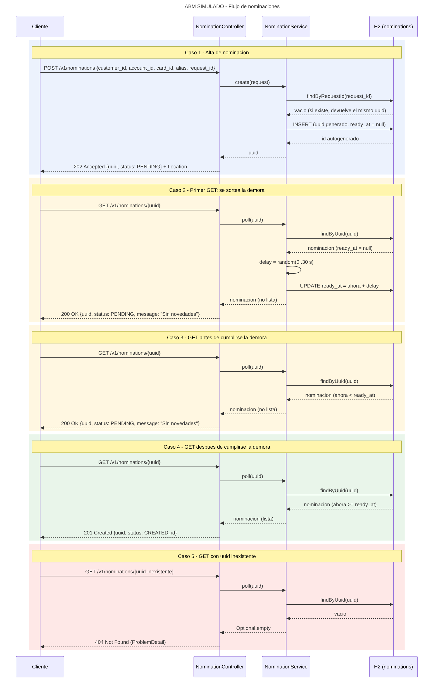

# ABM SIMULADO

API REST Spring Boot 3 (Java 17+) que simula un servicio asincrono. Persiste en H2 via JPA y se documenta con Swagger (springdoc).

## Ejecutar

```bash
mvn spring-boot:run
# o
mvn package && java -jar target/abm-simulado-1.0.0.jar
```

- Swagger UI: http://localhost:8080/swagger-ui.html
- OpenAPI JSON: http://localhost:8080/v3/api-docs
- Consola H2: http://localhost:8080/h2-console (JDBC URL `jdbc:h2:file:./data/abmdb`, usuario `sa`, sin clave)

## Flujo

| Paso | Llamada | Respuesta |
|---|---|---|
| 1 | `POST /v1/nominations` | **202** `{"uuid":"...","status":"PENDING","message":"Solicitud recibida"}` + header `Location` |
| 2 | `GET /v1/nominations/{uuid}` (primera vez) | Sortea demora 0–30 s. **200** `{"uuid":"...","status":"PENDING","message":"Sin novedades"}` |
| 3 | `GET` antes de cumplirse la demora | **200** sin novedades |
| 4 | `GET` despues de la demora | **201** `{"uuid":"...","status":"CREATED","message":"Creado","id":1}` |
| - | `GET` con uuid inexistente | **404** |

- `request_id` funciona como clave de idempotencia: repetir el POST devuelve el mismo `uuid`.
- La demora maxima se ajusta con `abm.simulado.max-delay-seconds` en `application.properties`.

## Ejemplo con curl

```bash
curl -i -X POST http://localhost:8080/v1/nominations \
  -H 'Content-Type: application/json' \
  -d '{"customer_id":"123456","account_id":"987654","card_id":"TOKEN_OR_MASKED_REFERENCE","alias":"CUENTA_PRINCIPAL","request_id":"8fcb3fa0-7f19-4fc2-a803-cc76ac815001"}'

curl -i http://localhost:8080/v1/nominations/<uuid>
```

## Diagrama de secuencia



Fuente Mermaid: `docs/abm-simulado-secuencia.mermaid`
